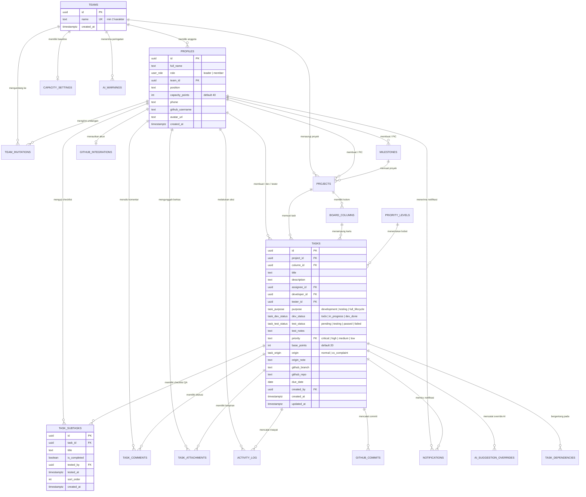

# Skema Basis Data & Row Level Security (RLS)

Basis data **Workhub** berjalan di atas **PostgreSQL (Supabase Cloud)** dan terdiri atas **18 tabel utama** yang dikelola melalui sistem migrasi berurutan di `supabase/migrations/`.

---

## 1. Entity Relationship Diagram (ERD)

---

## 2. Daftar Tabel & Spesifikasi Domain

### A. Organisasi, Profil, & Kapasitas

1. **`teams`**: Menyimpan unit tim/squad organisasi (misal: `Aegis`, `Sentinel`, `Management`, serta tim baru yang dibuat secara dinamis oleh otoritas Management dengan batasan `CHECK (length(trim(name)) >= 2)`).
   - Tim **`Management`** (`id: e3333333-3333-3333-3333-333333333333`) berfungsi sebagai otoritas lintas-tim (Head of Tech / Executive) dan diproteksi agar namanya tidak dapat diubah atau dihapus.
2. **`profiles`**: Memperluas `auth.users` Supabase dengan atribut aplikasi: `full_name`, `role` (`leader` | `member`), `team_id`, `position` (jabatan teknis), `capacity_points` (kapasitas poin individu, default `40`), `phone`, `github_username`, dan `avatar_url`.
3. **`team_invitations`**: Menyimpan undangan anggota tim berbasis email dengan token unik, status (`pending`, `accepted`, `expired`, `revoked`), dan masa berlaku 7 hari.
4. **`priority_levels`**: Tabel referensi bobot prioritas untuk kalkulasi beban kerja (`critical = 4`, `high = 3`, `medium = 2`, `low = 1`).
5. **`capacity_settings`**: Menyimpan _baseline_ kapasitas poin standar per tim (`baseline_points`, default `20`).

### B. Hierarki Kerja (Milestone, Project, Kanban, Task)

6. **`milestones`**: Target strategis tingkat atas lintas tim. Memiliki `status` (`planned`, `in_progress`, `completed`, `at_risk`), `pic_id`, `start_date`, `target_date`, dan dukungan pengarsipan (`archived_at`).
7. **`projects`**: Proyek kerja yang menginduk pada satu `milestone_id` dan terikat ke satu `team_id`. Memiliki `status` (`planned`, `in_progress`, `completed`, `blocked`) dan `archived_at`.
8. **`board_columns`**: Kolom papan Kanban kustom per proyek (`position` terurut, misal: _To Do_, _In Progress_, _Review / QA_, _Done_).
9. **`tasks`**: Unit pekerjaan utama di papan Kanban. Mendukung:
   - **Dual-Assignee & Alur QA**: `developer_id`, `tester_id`, `purpose` (`development`, `testing`, `full_lifecycle`), `dev_status` (`todo`, `in_progress`, `dev_done`), `test_status` (`pending`, `testing`, `passed`, `failed`), dan `test_notes`.
   - **Pelacakan Komplain CS**: `origin` (`normal` | `cs_complaint`) dengan constraint wajib `origin_note` apabila berasal dari komplain CS.
   - **Isolasi GitHub Multi-Repo**: `github_branch` dan `github_repo` (nama repo atau `owner/repo` untuk mencegah bentrok nama branch antar-repositori).
10. **`task_subtasks`**: Daftar periksa (_checklist_) pengujian per task yang mencatat status selesai (`is_completed`), penguji (`tested_by`), dan waktu pengujian (`tested_at`).
11. **`task_dependencies`**: Relasi ketergantungan antar-task (`task_id` menunggu `depends_on_task_id` selesai), dilengkapi constraint anti-self-dependency (`task_id <> depends_on_task_id`).
12. **`task_comments`**: Diskusi berulir pada halaman detail task.
13. **`task_attachments`**: Metadata lampiran berkas yang disimpan di bucket Supabase Storage `task-attachments` (batas ukuran 5 MB).
14. **`activity_log`**: Catatan audit otomatis untuk setiap perubahan field penting pada task (`column_id`, `priority`, `assignee_id`, `due_date`, `title`, `description`, `project_id`, `github_branch`, `github_repo`).

### C. Integrasi GitHub, Notifikasi, & Kecerdasan Buatan (AI)

15. **`github_integrations`**: Menyimpan token akses OAuth GitHub pengguna untuk integrasi API.
16. **`github_commits`**: Menyimpan riwayat commit GitHub yang disinkronkan melalui webhook push (`task_id`, `commit_sha`, `commit_message`, `author_username`, `committed_at`, `url`), dengan constraint unik `(task_id, commit_sha)` agar idempoten.
17. **`notifications`**: Notifikasi dalam aplikasi (_in-app_) untuk kejadian `task_assigned`, `comment_mention`, `due_soon`, `overdue`, dan `ai_warning`.
18. **`ai_query_cache`**, **`ai_warnings`**, & **`ai_suggestion_overrides`**:
    - `ai_query_cache`: Menyimpan _hash_ pertanyaan dan respons AI untuk menghemat pemanggilan LLM berulang.
    - `ai_warnings`: Peringatan risiko beban kerja dan kuartalan dari asisten AI.
    - `ai_suggestion_overrides`: Mencatat perbandingan saran prioritas/durasi dari AI dengan keputusan akhir yang dipilih oleh Leader.

---

## 3. Database Triggers Otomatis

| Nama Trigger               | Tabel Target   | Fungsi & Perilaku                                                                                                                                                                                           |
| :------------------------- | :------------- | :---------------------------------------------------------------------------------------------------------------------------------------------------------------------------------------------------------- |
| `on_auth_user_created`     | `auth.users`   | Menjalankan `public.handle_new_user()` untuk membuat baris `profiles` secara otomatis saat pengguna baru mendaftar, serta mencocokkan undangan pending di `team_invitations`.                               |
| `on_task_activity_updated` | `public.tasks` | Menjalankan `public.log_task_activity()` (`AFTER UPDATE`) untuk membandingkan nilai lama (`OLD`) dan nilai baru (`NEW`) pada 9 kolom utama task dan menyisipkan riwayat perubahan ke `public.activity_log`. |

---

## 4. Arsitektur Row Level Security (RLS)

Seluruh tabel di skema `public` mengaktifkan **Row Level Security (`ENABLE ROW LEVEL SECURITY`)** dengan prinsip berikut:

1. **Optimasi Performa Subquery**: Seluruh kebijakan RLS menggunakan `(select auth.uid())` alih-alih `auth.uid()` langsung agar PostgreSQL mengevaluasi sesi satu kali per query (_initPlan_), bukan per baris.
2. **Akses Baca Terautentikasi (`SELECT`)**: Pengguna dengan peran `authenticated` dapat membaca direktori profil, tim, milestone, project, dan task untuk kebutuhan kolaborasi lintas fungsi, sementara `notifications` dan `github_integrations` dibatasi ketat hanya untuk pemilik data (`user_id = (select auth.uid())`).
3. **Otorisasi Mutasi Berjenjang (`INSERT / UPDATE / DELETE`)**:
   - **Management Team**: Memiliki hak akses lintas-squad untuk membuat/mengedit tim baru, mengelola proyek, dan menugaskan anggota.
   - **Leader Squad**: Memiliki hak membuat/mengubah Milestone, Project pada timnya, mengundang anggota ke timnya, serta mengatur kolom Kanban.
   - **Member Squad**: Memiliki hak memperbarui status pengerjaan task, menambahkan komentar, mengunggah lampiran, mencentang subtask pengujian, dan menautkan branch/repository GitHub.
4. **Operasi Sistem & Webhook (`service_role`)**: Endpoint mesin-ke-mesin seperti `/api/github-webhook` menggunakan `createAdminClient()` setelah memverifikasi tanda tangan kriptografis HMAC-SHA256.
