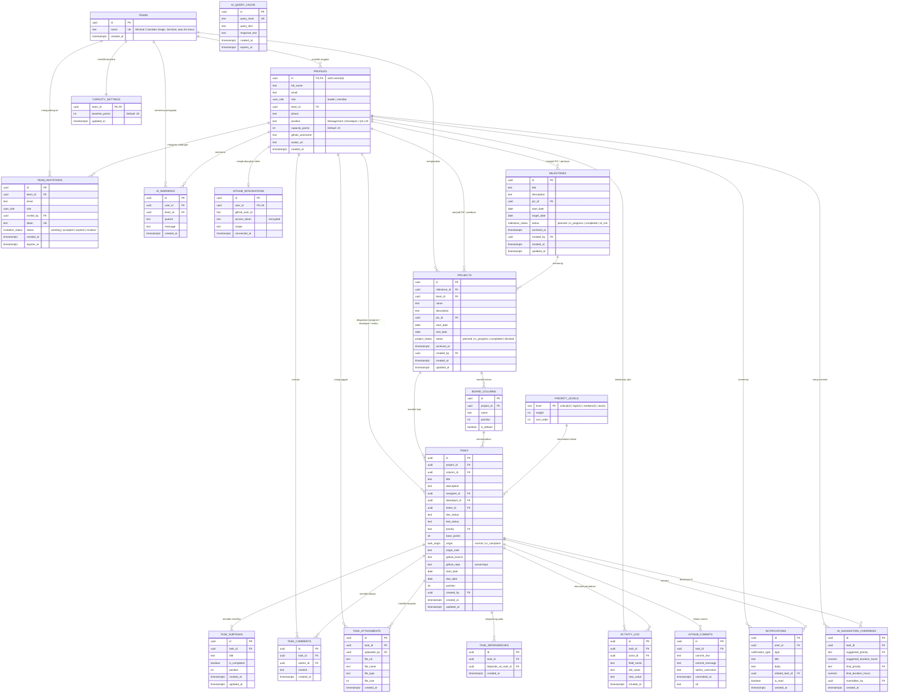
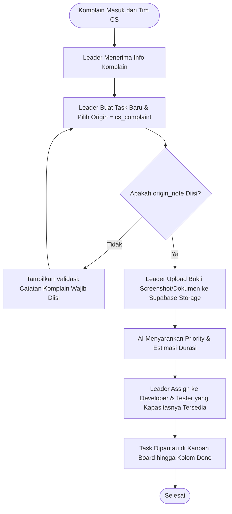
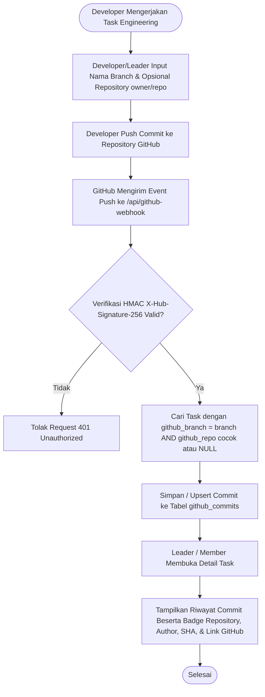
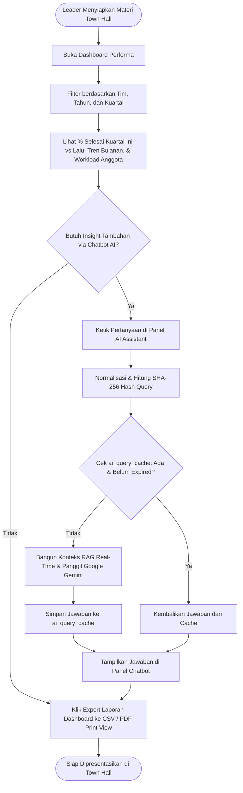
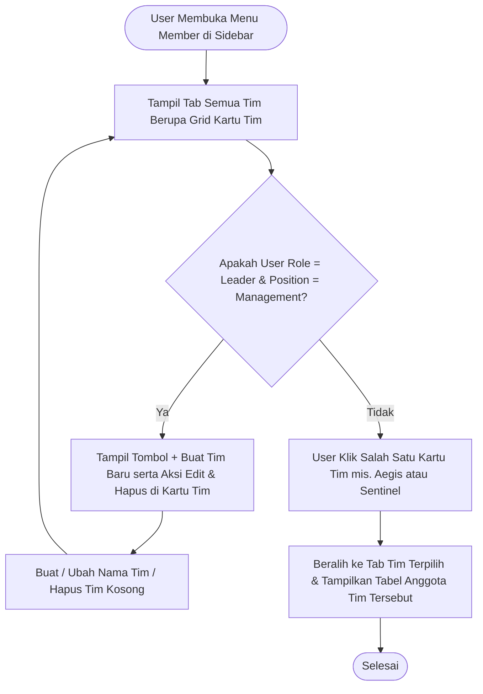
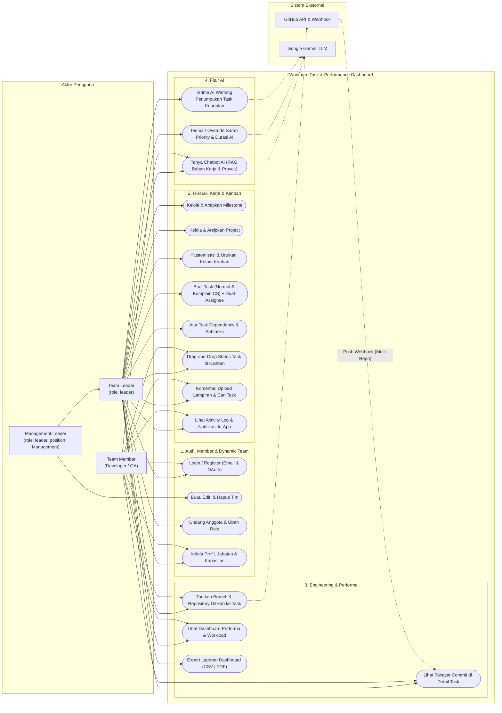

# Diagram Sistem: Workhub (Task & Performance Dashboard)

Dokumen ini berisi 3 diagram utama dalam format Mermaid:

1. ERD (Entity Relationship Diagram) untuk 18 tabel database beserta relasi, PK, dan FK.
2. Activity Diagram untuk 5 alur proses utama aplikasi (Perencanaan Target & Dual-Assignee QA, Komplain CS, Integrasi GitHub Multi-Repo, Chatbot AI & Guardrails, serta Manajemen Tim Dinamis).
3. Use Case Diagram untuk hak akses antara aktor Management Leader, Team Leader, Member (Developer / QA), serta Sistem Eksternal (GitHub & Gemini LLM).

---

## 1. Entity Relationship Diagram (ERD)

---

## 2. Activity Diagram

### 2.1 Alur 1: Perencanaan Target, Pembuatan Task, Dual-Assignee QA, & Eksekusi Kanban

```mermaid
flowchart TD
    Start([Mulai]) --> Login[User Login via Email/Password atau OAuth Google/GitHub]
    Login --> AuthCheck{Cek Role di Supabase RLS}

    AuthCheck -- Leader --> CreateMilestone[Leader Membuat Milestone Strategis + Set PIC & Target Date]
    CreateMilestone --> CreateProject[Leader Membuat Project di bawah Milestone & Pilih Tim]
    CreateProject --> SetupBoard[Sistem Otomatis Membuat 4 Kolom Kanban Default]
    SetupBoard --> CreateTask[Leader Membuka Form Buat Task Baru]

    CreateTask --> AISuggest[AI Auto-Prioritizing: Sarankan Priority & Estimasi Durasi]
    AISuggest --> OverrideCheck{Leader Mengubah Saran AI?}
    OverrideCheck -- Ya --> LogOverride[Catat ke Tabel ai_suggestion_overrides]
    OverrideCheck -- Tidak --> AssignMember[Leader Assign Developer, Tester/QA, Dependency, & Subtasks]
    LogOverride --> AssignMember

    AssignMember --> SaveTask[Simpan Task ke Database & Trigger activity_log]
    SaveTask --> NotifyMember[Kirim Notifikasi In-App task_assigned]
    NotifyMember --> CalcWorkload[Hitung Ulang Workload: Bobot Task x Persentase Peran Dev 100% / QA 50%]

    CalcWorkload --> OverloadCheck{Workload > 80%?}
    OverloadCheck -- Ya --> FlagOverload[Tandai Status OVERLOAD & Kirim Notifikasi member_overload ke Leader]
    OverloadCheck -- Tidak --> ReadyKanban[Task Tampil di Kolom Kanban]
    FlagOverload --> ReadyKanban

    AuthCheck -- Member --> ViewKanban[Member Membuka Papan Kanban Project]
    ReadyKanban --> ViewKanban

    ViewKanban --> DragTask[Developer / Tester Drag-and-Drop Kartu Task & Checklist Subtasks]
    DragTask --> DepCheck{Ada Task Dependency Belum Selesai?}
    DepCheck -- Ya (ke Done) --> WarnDep[Tampilkan Indikator Blocked by Dependency]
    DepCheck -- Tidak --> UpdateCol[Update column_id, dev_status, atau test_status]
    WarnDep --> UpdateCol

    UpdateCol --> LogStatus[Catat Otomatis ke activity_log & Kirim Notifikasi task_status_changed]
    LogStatus --> End([Selesai])
```

### 2.2 Alur 2: Penanganan Task dari Komplain CS

### 2.3 Alur 3: Integrasi GitHub Multi-Repository & Pelacakan Commit

### 2.4 Alur 4: Penggunaan Chatbot AI (RAG) & Evaluasi Laporan Town Hall

### 2.5 Alur 5: Manajemen Tim Dinamis & Direktori Member (Menu "Member")

---

## 3. Use Case Diagram

